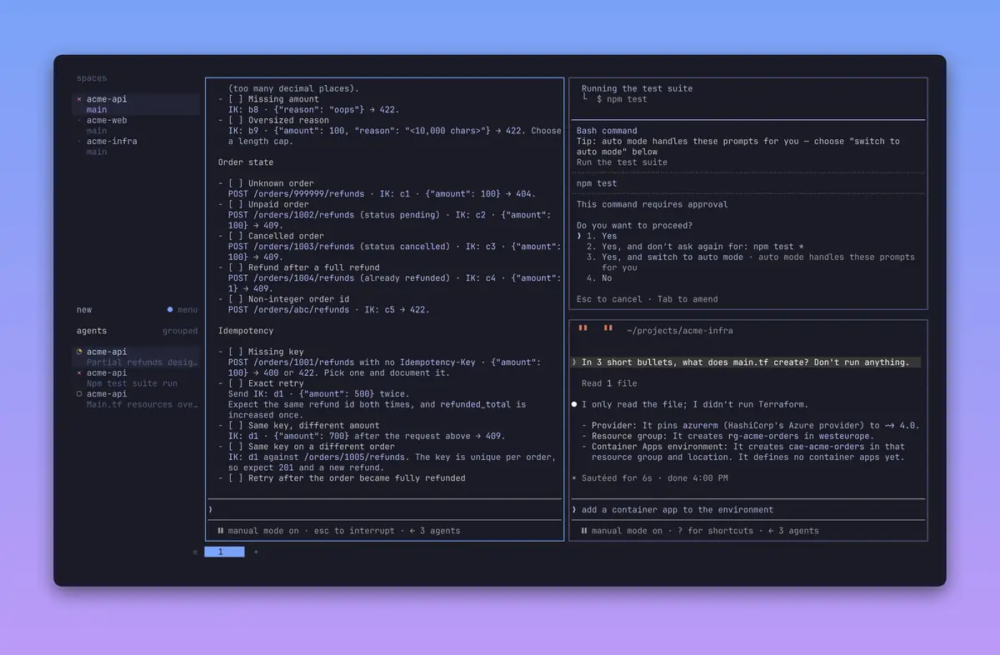
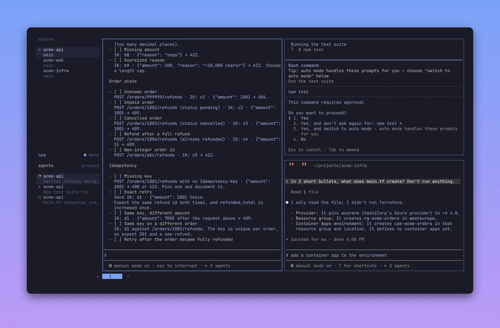
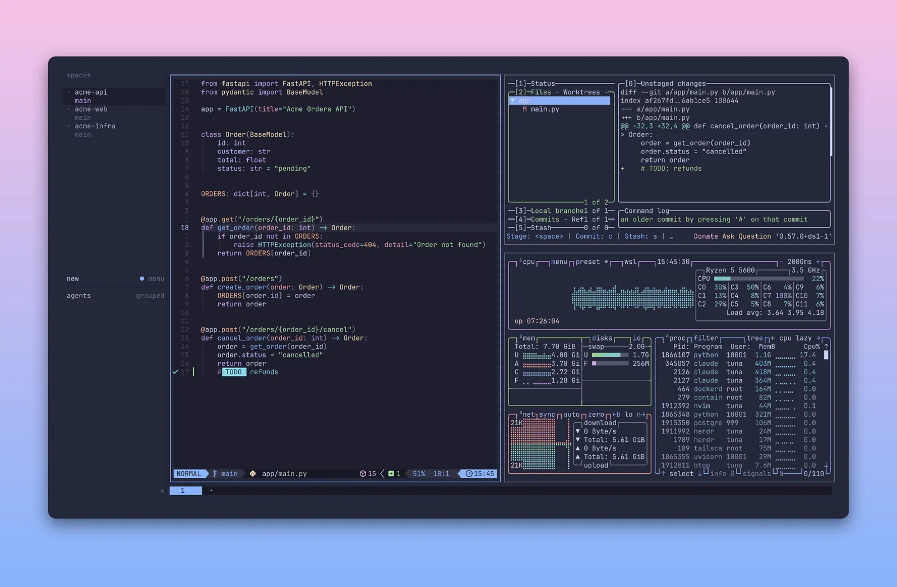
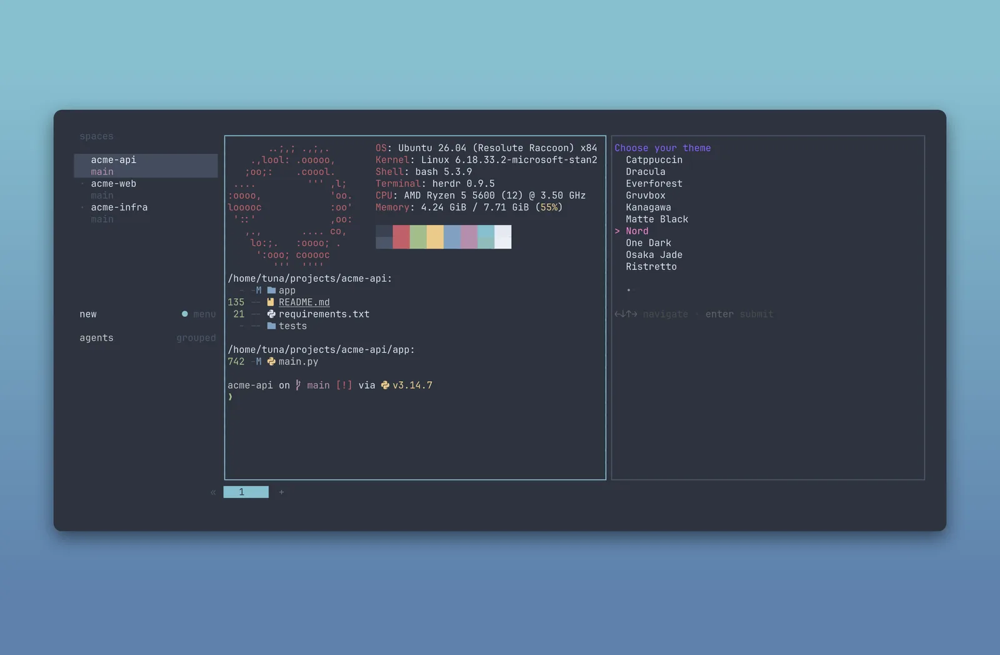
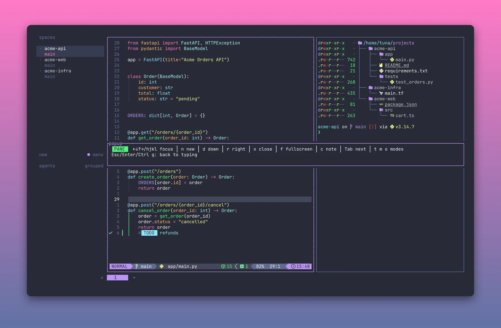
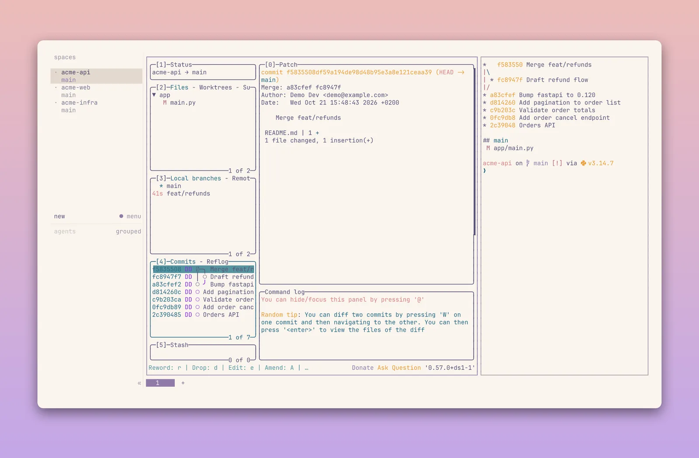
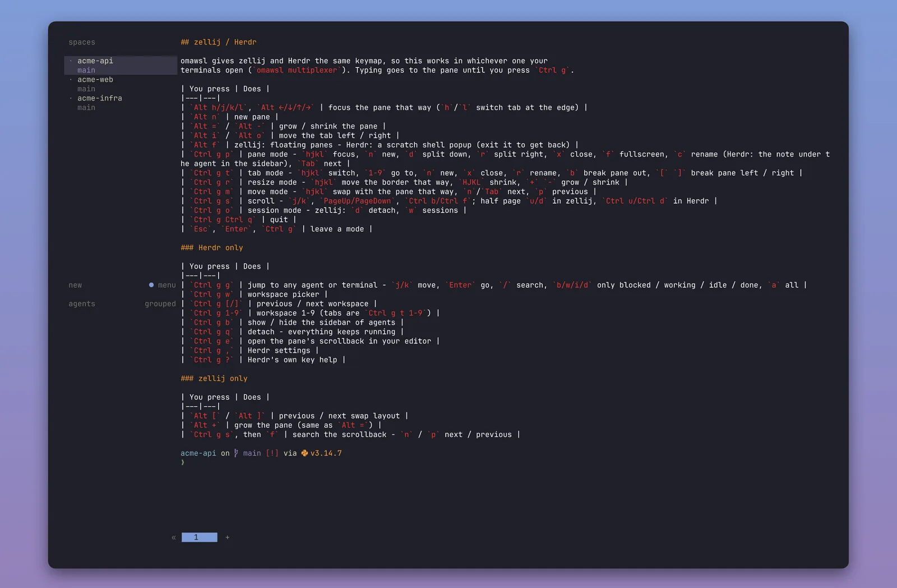

<p align="center">
  
</p>

<h1 align="center">WSL, fully loaded.</h1>

<p align="center">
  One command turns a fresh WSL2 Ubuntu into a dev machine you'll love.<br>
  <sub>The <a href="https://github.com/basecamp/omakub">Omakub</a> "one script, done" experience, for Windows 11.</sub>
</p>

<p align="center">
  <a href="https://github.com/tunacinsoy/omawsl/releases"></a>
  
  
  
</p>

<p align="center">
  
</p>

```bash
curl -fsSL https://raw.githubusercontent.com/tunacinsoy/omawsl/master/boot.sh | bash
```

## What you get

<table>
  <tr>
    <td width="45%"><b>A terminal that feels like home</b><br><sub>Panes, tabs, git and monitoring.</sub></td>
    <td><code>zellij</code> <code>Herdr</code> <code>lazygit</code> <code>lazydocker</code> <code>btop</code> <code>gh</code></td>
  </tr>
  <tr>
    <td><b>Your languages, nothing else</b><br><sub>Pick what you need. Nothing is pre-ticked.</sub></td>
    <td><code>Ruby on Rails</code> <code>Node.js</code> <code>Go</code> <code>Python</code> <code>Rust</code> <code>Java</code> <code>PHP</code> <code>Elixir</code></td>
  </tr>
  <tr>
    <td><b>AI agents, side by side</b><br><sub>Herdr plays a sound when one needs you.</sub></td>
    <td><code>Claude Code</code> <code>Copilot CLI</code> <code>Codex</code> <code>opencode</code> <code>Antigravity</code></td>
  </tr>
  <tr>
    <td><b>Editors, themed to match</b><br><sub>The same colors in your terminal and editor.</sub></td>
    <td><code>Neovim</code> <code>VS Code</code> <code>Cursor</code></td>
  </tr>
  <tr>
    <td><b>Docker, no Desktop needed</b><br><sub>Native Engine, databases in containers.</sub></td>
    <td><code>Docker</code> <code>PostgreSQL</code> <code>MySQL</code> <code>Redis</code></td>
  </tr>
  <tr>
    <td><b>Cloud CLIs on tap</b><br><sub>Sign in and go.</sub></td>
    <td><code>Azure CLI</code> <code>AWS CLI</code> <code>GCP CLI</code> <code>Terraform</code></td>
  </tr>
  <tr>
    <td><b>Safe on a work laptop</b><br><sub>Never installs or starts Windows software. <a href="docs/config-safety.md">Never overwrites your config.</a></sub></td>
    <td>🛡️ <sub>corporate-friendly</sub></td>
  </tr>
</table>

## See it

<table>
  <tr>
    <td width="50%"><br><b>Three agents, one screen</b> <sub>· Tokyo Night</sub></td>
    <td width="50%"><br><b>Code, git and system at a glance</b> <sub>· Catppuccin</sub></td>
  </tr>
  <tr>
    <td><br><b>Pick a theme, everything follows</b> <sub>· Nord</sub></td>
    <td><br><b>Hints for every mode</b> <sub>· Dracula</sub></td>
  </tr>
  <tr>
    <td><br><b>Git without the typing</b> <sub>· Rosé Pine</sub></td>
    <td><br><b>Every shortcut, one command</b> <sub>· Kanagawa</sub></td>
  </tr>
</table>

<p align="center"><sub>
  All 13 themes: Catppuccin · Dracula · Everforest · Gruvbox · Kanagawa · Matte Black · Nord · One Dark · Osaka Jade · Ristretto · Rosé Pine · Solarized · Tokyo Night
</sub></p>

## Your daily commands

<table>
  <tr><td width="45%"><code>omawsl theme</code></td><td>Switch the look everywhere, Windows Terminal included</td></tr>
  <tr><td><code>omawsl update</code></td><td>Update omawsl, runtimes and tools (<a href="docs/updating.md">how</a>)</td></tr>
  <tr><td><code>omawsl install</code></td><td>Add something you skipped</td></tr>
  <tr><td><code>omawsl keys</code></td><td>Forgot a shortcut? Look it up (<a href="docs/keys.md">all keys</a>)</td></tr>
  <tr><td><code>omawsl multiplexer</code></td><td>Switch between zellij and <a href="docs/herdr.md">Herdr</a></td></tr>
  <tr><td><code>omawsl doctor</code></td><td>Check that everything's healthy</td></tr>
</table>

<sub>Run <code>omawsl</code> with no arguments for the full list.</sub>

## Good to know

<details>
<summary><b>Before you begin</b>: no WSL yet?</summary>
<br>

Open PowerShell as Administrator:

```powershell
wsl --install -d Ubuntu
```

Then run the one-liner above inside Ubuntu. If `wsl --install` fails (virtualization off in the BIOS, an old Windows build), see [Microsoft's WSL install guide](https://learn.microsoft.com/windows/wsl/install).

</details>

<details>
<summary><b>Using VS Code, Cursor or Docker Desktop on Windows?</b></summary>
<br>

Install them on Windows first and the installer will have nothing to flag. The [quick-reference table](docs/windows-setup.md#quick-reference) lists what each choice needs. Windows Terminal itself and its font are set up by hand, also in [Windows setup](docs/windows-setup.md).

</details>

<details>
<summary><b>What omawsl deliberately excludes</b></summary>
<br>

- **37signals commercial products** (HEY, Basecamp): out of scope for a dev environment.
- **The Windows desktop-app layer** (Spotify, Signal, GNOME, Ulauncher): WSL has no desktop to run them in.
- **Any automatic Windows-side software installation** (winget, PowerShell installs): many work laptops need an IT ticket for that. [Windows setup](docs/windows-setup.md) covers the manual route.
- **Typora** and **X11 compose keys**: not central enough, and Windows owns the keyboard.

</details>

## Docs

[Windows setup](docs/windows-setup.md) · [Keys](docs/keys.md) · [Herdr](docs/herdr.md) · [Updating](docs/updating.md) · [Config safety](docs/config-safety.md) · [Testing changes](docs/testing-changes.md) · [Contributing](CONTRIBUTING.md)

<p align="center"><sub>Inspired by <a href="https://github.com/basecamp/omakub">Omakub</a> · made for WSL2 on Windows 11</sub></p>
